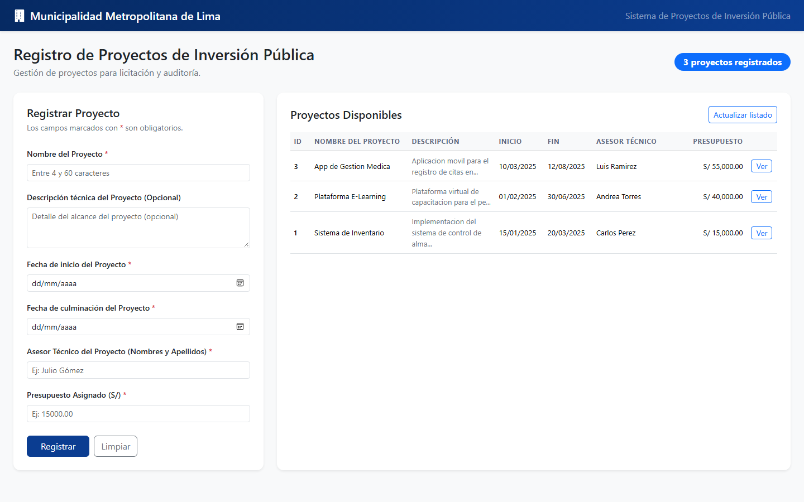
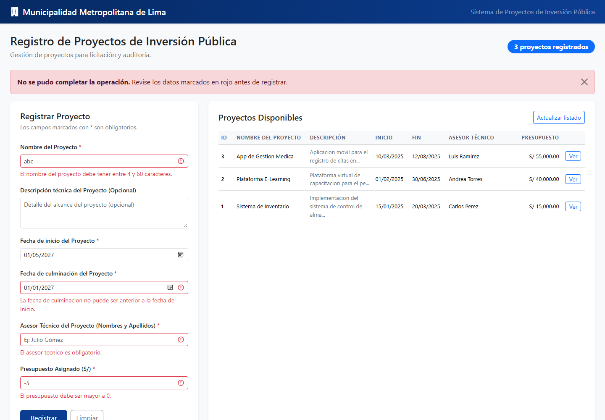
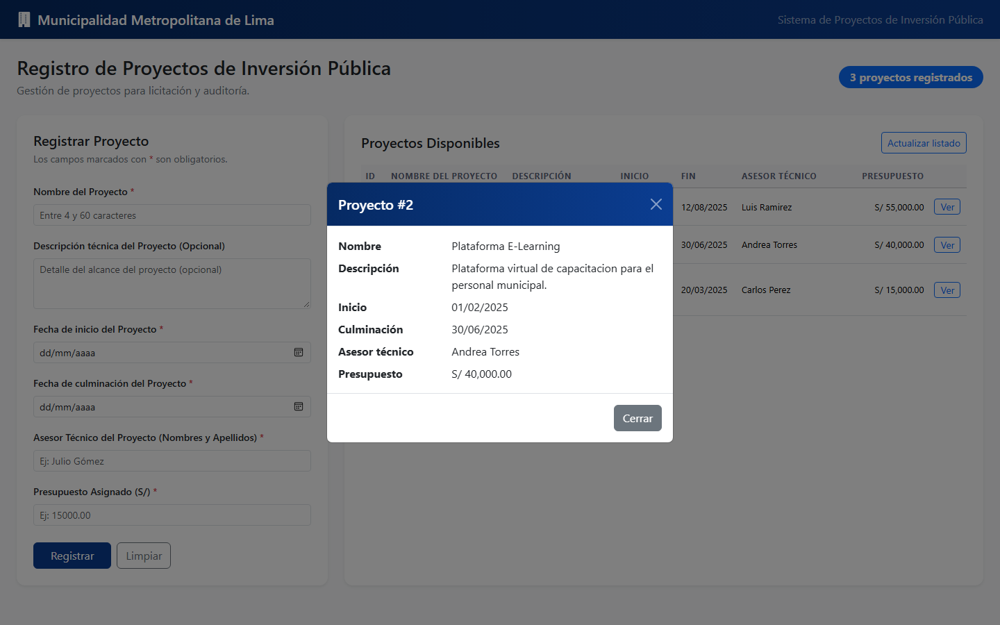

# T1 - Proyectos de Inversión Pública (JSP + Servlet + JDBC)

Evaluación de Laboratorio Nro 1 del curso **Lenguaje de Programación I** (CIBERTEC, ciclo 3).
Aplicación web para registrar y listar los **Proyectos de Inversión Pública** de la
Municipalidad Metropolitana de Lima.

- **Alumno:** Ander Vásquez
- **Docente:** Jorge Enrique Ventura Gonzáles
- **Ciclo / Sección:** Tercero / T3YT
- **Fecha:** 16/11/2026

## Tecnologías

| Capa | Tecnología |
|---|---|
| Vista | JSP 4.0 + Bootstrap 5.3 (local, sin CDN) |
| Controlador | Servlet 6.1 (`jakarta.servlet`) |
| Persistencia | JDBC + patrón DAO (`PreparedStatement`) |
| Base de datos | SQL Server 2025 (script alternativo para MySQL) |
| Servidor | Apache Tomcat 11.0.4 |
| Java | 17+ |

## Capturas

**Registro y listado**



**Validaciones del lado del servidor**



**Detalle del proyecto**



## Estructura del proyecto

```
T1_ProyectosMuni/
├─ db/
│  ├─ bd_proyectos_muni_sqlserver.sql    -- script para SQL Server
│  └─ bd_proyectos_muni_mysql.sql        -- script alternativo para MySQL
├─ src/main/java/
│  ├─ db.properties                      -- configuración de conexión
│  └─ pe/cibertec/
│     ├─ entidades/Proyecto.java
│     ├─ interfaces/IProyectoDAO.java
│     ├─ dao/ProyectoDAO.java
│     ├─ database/Conexion.java
│     ├─ validacion/ValidadorProyecto.java
│     ├─ util/Texto.java
│     └─ servlet/ProyectoServlet.java
├─ src/main/webapp/
│  ├─ index.jsp                          -- redirige al controlador
│  ├─ proyectos.jsp                      -- formulario + listado
│  ├─ error.jsp
│  ├─ assets/                            -- Bootstrap y estilos
│  └─ WEB-INF/
│     ├─ web.xml
│     └─ lib/mssql-jdbc.jar
├─ build.ps1                             -- compila y genera el WAR
└─ dist/T1_ProyectosMuni.war             -- entregable
```

## 1. Base de datos

### SQL Server

```powershell
sqlcmd -S localhost -E -C -i db\bd_proyectos_muni_sqlserver.sql
```

El script crea:

- Base de datos `BD_ProyectosMuni`
- Tabla `dbo.proyectos` con restricciones de fechas y presupuesto
- 3 registros de ejemplo
- Usuario de aplicación `usr_proyectos` / `Proyectos2026*`

> Requisito: el protocolo **TCP/IP** del motor debe estar habilitado en el puerto 1433
> (SQL Server Configuration Manager → Protocols for MSSQLSERVER → TCP/IP → Enabled).

### MySQL (alternativa)

```powershell
mysql -u root -p < db\bd_proyectos_muni_mysql.sql
```

Luego en `src/main/java/db.properties` comenta el bloque de SQL Server y usa:

```properties
db.driver=com.mysql.cj.jdbc.Driver
db.url=jdbc:mysql://localhost:3306/BD_ProyectosMuni?useSSL=false&serverTimezone=America/Lima&characterEncoding=UTF-8
db.usuario=root
db.clave=TU_CLAVE
```

Y reemplaza el driver de `WEB-INF/lib` por `mysql-connector-j-9.x.x.jar`.

## 2. Ejecutar en Eclipse

1. `File → Import → General → Existing Projects into Workspace`
2. Directorio raíz: esta carpeta (`T1_ProyectosMuni`)
3. Verificar que el *Target Runtime* sea **Apache Tomcat v11.0.4**
4. Clic derecho al proyecto → `Run As → Run on Server` → Tomcat 11
5. Abrir: <http://localhost:8080/T1_ProyectosMuni/>

## 3. Generar el WAR

```powershell
.\build.ps1                 # solo compila
.\build.ps1 -Desplegar      # compila y copia a Tomcat\webapps
```

Resultado: `dist\T1_ProyectosMuni.war`

## 4. Validaciones implementadas (Ítem 01)

| Campo | Regla | Lado |
|---|---|---|
| Nombre del Proyecto | Obligatorio, 4 a 60 caracteres | Cliente + Servidor |
| Descripción técnica | Opcional, máximo 255 caracteres | Cliente + Servidor |
| Fecha de inicio | Obligatoria, fecha válida | Cliente + Servidor |
| Fecha de culminación | Obligatoria, no anterior al inicio | Cliente + Servidor |
| Asesor Técnico | Obligatorio, 3 a 80 caracteres | Cliente + Servidor |
| Presupuesto | Obligatorio, numérico, mayor a 0, 2 decimales | Cliente + Servidor |

Los mensajes de error se muestran con el componente `invalid-feedback` de Bootstrap
y el formulario conserva los datos ingresados.

## 5. Funcionalidades (Ítems 02 y 03)

- **Registro:** `POST /ProyectoServlet` → valida → `ProyectoDAO.registrar()` → `INSERT` con `PreparedStatement`.
- **Listado:** `GET /ProyectoServlet` → `ProyectoDAO.listar()` → `SELECT` → tabla con todos los campos.
- **Detalle:** botón *Ver* con ventana modal de Bootstrap (sin recargar la página).
- **Patrón:** vista JSP ← Servlet controlador ← DAO ← JDBC.

## 6. Credenciales de la base de datos

| Parámetro | Valor |
|---|---|
| Base de datos | `BD_ProyectosMuni` |
| Usuario | `usr_proyectos` |
| Clave | `Proyectos2026*` |
| Tabla | `dbo.proyectos` |

> En un entorno real estas credenciales no deben versionarse; aquí se incluyen
> porque es un trabajo académico y el docente necesita reproducir la evaluación.
